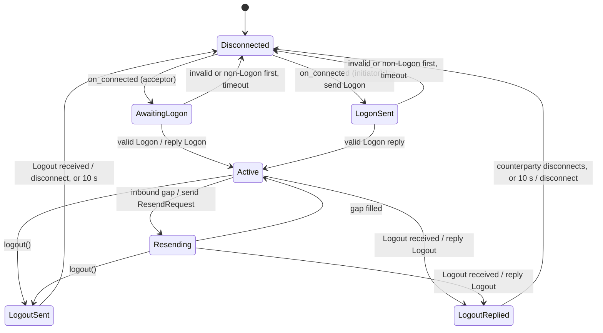

# 003 — Session

**Status:** Measured · **Updated:** 2026-10-22

## Proposal

The session makes one connection's message stream reliable and ordered across reconnects: logon
and logout, heartbeats and test requests, sequence numbers in both directions, resend and gap
fill, and session-level rejects. It is the first state machine of note 001 (one per connection);
the order state machine (note 007) sits above it and sees only application messages, in order,
once each.

It is written from FIX 4.4 Volume 2 and the *FIX Session Layer Technical Standard*, and shaped by
the *FIX Session Layer Test Cases* (V1.0, June 2020): every mandatory scenario there must be
expressible as a script of bytes and clock ticks against this session, because note 006 will
script all of them.

It does:

- both roles: initiator (sends Logon, waits for the reply) and acceptor (waits for Logon,
  validates the counterparty, replies);
- the inbound sequence rules (as expected, too high, too low, PossDup), ResendRequest in both
  directions, SequenceReset in both modes, Reject, Logout in both directions;
- heartbeat and TestRequest timing, logon and logout timeouts;
- header checks: BeginString, CompIDs, SendingTime accuracy, PossDup with OrigSendingTime;
- serving a counterparty's ResendRequest from the store: application messages and Reject resent
  with PossDupFlag=Y and OrigSendingTime; the other admin messages replaced by gap fills;
- outbound messages queued while not logged on (scenario 16), sent after recovery.

It does not:

- own a socket, a clock, a thread or a file (sans-I/O, note 001): bytes and ticks in, bytes and
  actions out;
- persist anything. Its inputs are journaled by the engine loop and recovery is replay (notes 004
  and 005); this note defines what the session needs from a store, not the store;
- validate application message bodies beyond what the codec already checks; that is note 007's,
  for the five order-entry messages, with Business Message Reject for unsupported types;
- support encryption (scenario 17, optional: EncryptMethod must be 0), third-party addressing
  (scenario 18, optional), or NextExpectedMsgSeqNum (789) at logon (optional in FIX 4.4). Each is
  listed in note 006 as not implemented, with this reason.

## Design

**Interface.** A session is a class template over a *sink* (where its outputs go) and a *store*
(where sent messages are read back for resends):

```cpp
template <class Sink, class Store> class session {
public:
    session(const session_config&, Sink&, Store&);
    void on_connected(time now);              // transport has a connection
    std::size_t on_bytes(const char*, std::size_t, time now);  // returns bytes consumed
    void on_tick(time now);                   // timers
    void on_disconnected(time now);
    send_result send(app_message, time now);  // from the application (note 007)
    void logout(std::string_view text, time now);
    session_state state() const;
};
```

`time` carries both clocks the session needs: a monotonic one for its timers and UTC for
SendingTime. The sink receives: bytes to write, *disconnect*, application messages delivered in
order, and events for the log (each with its reason). The store answers `sent(seq)` (the bytes of
an outbound message by sequence number, or nothing). Tests use a recording sink and an in-memory
store; the engine (note 005) uses the real ones. Both are template parameters, so the calls are
direct and inlined; no virtual call or allocation on the path.

**States.**



Every (state, input) pair has a defined result in one transition table in the code, and the
table is what the tests enumerate. Input classes: connected, bytes that frame a message (by
MsgType and by sequence class: as expected, too high, too low with or without PossDup), garbled
bytes, tick (by which timer is due), send, logout, disconnected.

**Inbound, per message** (after note 002's framer and decoder):

1. Garbled (frame or CheckSum fails, or the first three fields wrong): ignored, not counted, logged.
2. Invalid (decoded with a SessionRejectReason): Reject, the inbound number consumed.
3. Header: BeginString must be `FIX.4.4` (else Logout and disconnect); SenderCompID and
   TargetCompID must match the configuration (else Reject reason 9, Logout, disconnect);
   SendingTime within a configured tolerance of UTC now, default 120 s (else Reject reason 10,
   Logout, disconnect); PossDupFlag=Y needs OrigSendingTime (else Reject reason 1) not after
   SendingTime (else Reject reason 10).
4. Sequence: as expected, processed and the expected number advanced; too high, ResendRequest for
   the gap (decision D1 for the message itself); too low without PossDup, Logout and disconnect
   (except SequenceReset-Reset); too low with PossDup, ignored.
5. By MsgType: the session messages (Logon, Heartbeat, TestRequest, ResendRequest, Reject,
   SequenceReset, Logout) handled here; application messages delivered to the sink.

**Outbound.** Each message is stamped with the next outbound number, SenderCompID, TargetCompID
and SendingTime, encoded with note 002's encoder B into a buffer the session owns, handed to the
sink, and the number advanced. The store records it (note 004 decides how and when, and whether
before the bytes are written: that is the in-doubt window of note 001).

**Timers.** Heartbeat if nothing sent for HeartBtInt; TestRequest if nothing received for
HeartBtInt plus 20%; disconnect if still nothing received after a further HeartBtInt plus 20%.
Logon reply within a configured time (default 10 s) or disconnect. After our Logout, the
counterparty's within 10 s, then we disconnect (scenario 12 and 13a); after an unsolicited one,
ours is sent at once and the counterparty has 10 s to disconnect before we do (13b).

**Serving a ResendRequest** (BeginSeqNo to EndSeqNo, 0 meaning to the latest sent): application
messages and Reject read from the store and resent with PossDupFlag=Y, OrigSendingTime the
original SendingTime and a new SendingTime; runs of other admin messages, and anything the store
no longer has, replaced by one SequenceReset-GapFill each. An application hook decides per
message whether to resend or gap-fill it (a stale order, note 007); by default everything
resendable is resent. A ResendRequest received while our own is outstanding is served first
(scenario 20).

**Decisions for agreement** (each has a real alternative):

- **D1. A message above a gap.** (a) *Drop it*: send ResendRequest from the expected number to 0
  (to the latest), and process nothing above the gap until it is filled; the counterparty's resend
  brings it again. (b) *Queue it*, process it after the gap fills, and request only the gap. (a)
  is proposed: no buffer of out-of-order messages to bound, size or test, and FIX 4.4's EndSeqNo
  0 exists for exactly this; it costs resending what was already received once, rare in practice.
- **D2. Sending while not logged on** (scenario 16). (a) *The session queues application
  messages unnumbered* (a bounded queue, configured size, refusing when full) and numbers and
  sends them after logon and recovery, each passing the stale-order hook first. (b) *Number
  them at once* and let the counterparty's ResendRequest bring them out with PossDup. (c)
  *Refuse*; the application queues. (a) is proposed: an order is numbered only when it really goes
  out, so nothing on the counterparty's side looks like a resend of something it never saw, and
  the stale-order decision is made at the moment of sending.
- **D3. Outputs.** (a) *A sink as a template parameter*, called as outputs arise. (b) *An output
  list* the caller drains after each input. (a) is proposed: no buffer of actions to size, direct
  calls the compiler inlines; tests get the same view through a recording sink.
- **D4. ResetSeqNumFlag (141) at logon.** (a) *Supported both ways*: we may send it (configured,
  e.g. daily start) and must honour it when received, both sides restarting at 1. (b) *Never sent,
  rejected when received*, sequence numbers only ever reset out of band. (a) is proposed: venues
  differ, and some require it; the store (note 004) starts a new sequence epoch on a reset.

**Testing.** All of it runs without a network: bytes in, bytes and actions out, time advanced by
hand. Each state transition has a test; a fuzzer feeds random and mutated streams and tick
sequences to a pair of sessions talking to each other (initiator and acceptor) and checks the
invariants after every input. Determinism is a test: the same inputs to a new session give the
same outputs, byte for byte, which is what recovery by replay (note 004) depends on.

## Spec

- S1. Every (state, input class) pair has a defined result, each covered by a test.
- S2. Each mandatory scenario of the *Session Layer Test Cases* can be scripted against the
  session alone (bytes and ticks in, bytes and actions checked); here, one test per scenario for
  1B, 1S, 2 (b, c, e, f, g, i, k, o), 4, 6, 7, 8, 10, 11, 12, 13, 16, 19 and 20. Note 006 adds
  every remaining sub-case.
- S3. Deterministic: the same input sequence to a new session gives the same outputs, byte for
  byte, and the same state.
- S4. Invariants under fuzzing (a stated number of executions, initiator and acceptor paired):
  outbound numbers advance by exactly one per message sent; the inbound expected number never
  falls, except by an accepted SequenceReset-Reset or ResetSeqNumFlag; every application message
  is delivered at most once and in sequence order; no crash, no sanitizer report.
- S5. A resend answers every number in the requested range exactly once: resent with
  PossDupFlag=Y and OrigSendingTime, or covered by a gap fill.
- S6. Processing an inbound application message, and sending one, make no allocation or system
  call (the compiled-code check of notes 002 and 009).
- S7. Builds and passes on aarch64 (CI); clean under ASan, UBSan and TSan.

## Tasks

- [x] Session types, configuration, the transition table; recording sink, in-memory store
- [x] Logon and logout, both roles; timers
- [x] Inbound sequence rules, ResendRequest and SequenceReset (both directions); Reject
- [x] Outbound queue while not logged on (D2); stale-order hook
- [x] Scenario tests (S2); determinism (S3); S5
- [x] Paired fuzzer (S4); S6 check
- [x] aarch64 run (S7): CI, native arm64
- [ ] Review

## Review

| Date | Stage | Finding |
|---|---|---|
| 2026-10-22 | Draft | Written for review. Sources: FIX 4.4 Volume 2; *FIX Session Layer Technical Standard* (2020 errata); *FIX Session Layer Test Cases* V1.0 (June 2020), its scenario list read from a published HTML copy (FIXT 1.1 numbering; FIX 4.4's differs only in version-specific reject reasons), to be checked against the official document in note 006. Message recovery: only Reject among the admin messages is resent; the rest are gap-filled |
| 2026-10-22 | Agreed | Approved by Shep, all four decisions as proposed: D1 drop a message above a gap and request from the gap to 0; D2 the session queues application messages unnumbered while not logged on (bounded) and numbers them when sent, after the stale-order hook; D3 a sink as a template parameter; D4 ResetSeqNumFlag supported both ways |
| 2026-10-22 | Built (partial) | `include/fixgw/session.hpp`: the session as a class template over sink and store (D3), states and transitions as designed; inbound framing, decoding and checks in the order: garbled ignored (a frame starting `8=FIX.` with another version ends the session, scenario 2i, which the framer alone would only skip); invalid, Reject with the codec's reason; CompIDs and SendingTime (Reject 9 or 10, Logout, disconnect); SequenceReset-Reset whatever its number; too low (PossDup ignored, otherwise Logout with "MsgSeqNum too low, expecting E but received S"); PossDup without, or after, OrigSendingTime (Reject 1 or 10); too high (D1: one ResendRequest from the gap to 0, ResendRequest and Logout above a gap still handled); then by MsgType. Outbound stamped, encoded with encoder B (`add_raw` added for a body the caller built), recorded in the store, written. Resend: application messages and Reject from the store, re-encoded with PossDupFlag=Y, OrigSendingTime and a new SendingTime; runs of the rest, and anything missing, one gap fill each (PossDupFlag=Y, OrigSendingTime the time of sending). Not decided by the session: duplicate identity at logon (scenario 1S b) needs a view across sessions: the engine's, note 005. `tests/session_test.cpp`: 60 checks, every scenario listed in S2 plus D2, D4 and S3; four mutants (gap fill start, D1 delivering above a gap, TestRequest timing, Reset lowering by one) each caught, the last only after a boundary case was added. Passes under ASan and UBSan, TSan, and a baseline x86-64 build; the aarch64 cross-build compiles with warnings as errors but was not run (no qemu here, and this repo has no CI yet) |
| 2026-10-22 | Built | S6: `hot_path_subject` gains the session's inbound (`on_bytes`) and send paths over a sink and store that keep nothing; `check_hot_path.py` follows everything they call: 11 functions and 9,876 instructions from inbound, 2 and 780 from send; calls only to memory copies, comparisons and searches (the fortified `__memcpy_chk`, and `strlen` for the codec's reason strings) and the stack protector's abort; no indirect call, no syscall. An allocation planted in `send_reject` was caught. S4: `fuzz/fuzz_session.cpp`, an initiator and an acceptor joined by in-memory pipes and driven by the input (bytes delivered either way in any split, application sends, clock steps, corruption, raw injection, well-framed forged messages with chosen MsgType, MsgSeqNum near the expected one and optional session fields, reconnects, logouts; the first byte sets D4 on the initiator); invariants checked after every step. Run: 1,324,184 executions in 601 s, no breach, no sanitizer report; 724 coverage edges; the corpus merged into `fuzz/corpus_session` (1,481 inputs). Line coverage of `session.hpp` from the corpus 95.6%; the lines never run are the outbound-overflow error paths. One false alarm on the way, in the fuzzer's own invariant: with D4 on, a reconnect restarts the initiator at 1 by design; the invariant now allows a fall after a store reset. Open: S7's aarch64 run (the cross-build compiles; nothing here can run it); scenario 1S b to note 005 |
| 2026-10-22 | Measured | Reviewed and approved by Shep against the Spec: S1–S6 met as recorded above; S7 met for the sanitizers and x86-64, its aarch64 run still open (the cross-build compiles), to be closed by the means Shep chooses; scenario 1S b assigned to note 005. A functional component: no benchmark here; its cost is measured in note 008 |
| 2026-10-22 | Measured | S7 closed: CI run 39862133379 (commit `fd39a4e`) passes all four jobs; on arm64 (aarch64, GCC 15.2 in `ubuntu:26.04`, GitHub's native arm runner) `session_test` and every other test pass. The first run failed only `report_check`: `run.py` looked for the fetched `lockfree-ipc` under `build/` alone, and CI builds elsewhere; the test now passes the path |
