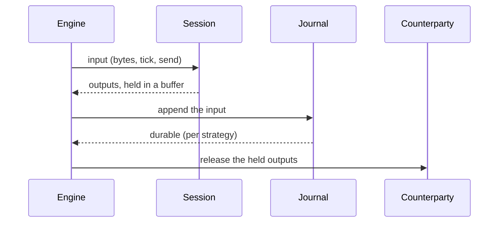

# 004 — Store and recovery

**Status:** Measured · **Updated:** 2026-10-25

## Proposal

Note 001 put recovery at the centre: the costly failure in order entry is not slowness but not
knowing whether an order exists. This note makes a session survive a crash. Its journal records
everything the session was given; recovery feeds the journal back to a new session, and because
the session is deterministic (note 003, S3) it arrives at exactly the state it had, sent messages
and sequence numbers included. The journal is the source of truth (note 001: event sourcing).

The hard rule follows from the in-doubt window: **no output leaves before the input that caused
it is durable.** If a message went out and the input behind it was lost, recovery would number
the next message with a number already used, and the counterparty would see one MsgSeqNum carry
two different messages. That cannot be repaired afterwards.

It does:

- the journal: an append-only file per session, records checksummed, a torn tail detected and
  cut;
- recovery by replay, and the session store of note 003 (sent messages, for resends) rebuilt by
  it;
- the four durability strategies of note 001, each with its guarantee stated and tested, and its
  cost measured on this machine;
- crash injection: the process killed at chosen points, restarted, and checked.

It does not:

- open sockets or run the engine loop (note 005). Here a session runs in a child process,
  connected through a socketpair to a counterparty session in the parent;
- feed databases or archives (note 001: off the hot path, later, from the journal);
- compact, roll or snapshot journals: one file per session, replayed whole (Review, 2026-10-23).

## Design

**What is journaled: the session's inputs**, in the order given, each with the clock readings
it was given (both clocks of note 003's `session_time`):

| Record | Payload |
|---|---|
| connected, disconnected | none |
| bytes | the bytes the session was offered and used (not a partial message left over) |
| tick | none; only ticks that changed something are kept (D2) |
| send | MsgType and body of an application message |
| logout | the reason text |

**The order of work, per input** (D1):

The session runs first, with a sink that holds its outputs: that costs nothing, since outputs
are only bytes in a buffer, and it tells the engine whether a tick did anything (D2). Then the
input is appended, made durable as the strategy says, and only then are the outputs released.

**Record format.** `length (u32), kind (u8), mono_ns (i64), utc_ms (i64), payload, CRC32C (u32)`.
On opening, records are read until one is short or fails its CRC: that is a torn write from the
crash, its outputs were never released (by the rule above), so it is cut off. One file per
session, replayed whole; a sequence reset (D4 of note 003) is replayed like any other input. The
header's epoch field is kept for a later split, which would need a snapshot of the session at the
start of each file (Review, 2026-10-23).

**The four strategies** (note 001's table), each a policy of the journal writer:

| Strategy | Made durable | Survives | Cost on the path |
|---|---|---|---|
| A. fsync each | `write`, then `fdatasync`, before release | power loss, if the device's write cache does | one `fdatasync` per input |
| B. group commit | inputs gathered up to a bound (count or µs), one `fdatasync` for the group | power loss, as A | the wait for the group, shared |
| C. memory-mapped | stored into a mapped file; never flushed on the path | the process dying (the page cache stays) | a memory copy |
| D. replicated | sent to a standby process, which appends it to its own journal and acknowledges | the loss of this machine, if the standby is on another | a round trip |

On this machine: the journal lives on `/` (ext4 on an HPE Smart Array logical volume; `/tmp` is
memory; C's file has lived on tmpfs since note 008's amendment, Review 2026-10-24), whose write cache the kernel sees as write-through. A probe (2,000 appends of 200 bytes,
each with `fdatasync`, normal mode): p50 130 µs, p99 261 µs, max 616 µs, too fast for the disks
alone, so the controller's cache is absorbing writes. Checked with `ssacli` (Review): the cache is
battery-backed (1.8 GB, 90% for writes), no-battery write caching is off and the drive's own
cache is off, so A and B survive power loss here. The volume is one 1 TB SAS disk in RAID 0: no
redundancy, so a disk failure loses the journal, which only D (a standby elsewhere) covers. A run
that writes faster than one disk drains would fill the cache and see `fdatasync` at disk speed;
each benchmark run records how much it wrote.

**Recovery.** Open the newest file, cut any torn tail, and replay every record into a new session
whose sink discards writes (they went out before the crash) and whose store records sent
messages as replay produces them. The session is then where it was. Messages already sent but
never acknowledged are recovered by the protocol itself: on the next logon the counterparty's
ResendRequest, or ours, covers them (note 003).

**The store** (note 003's interface) keeps sent messages in memory, appended in order, indexed by
sequence number (D3). It is rebuilt by replay on every start, so it is never a second source of
truth that could disagree with the journal.

**Crash injection.** Fail points compiled into a test build: before the append; mid-append (half
a record written, then `_exit`); after the append, before durable; after durable, before release;
mid-release (some outputs written); during a resend. The child is killed at the point, restarted
with recovery, and the test checks, against the counterparty's record of everything it received:
no MsgSeqNum ever carries two different messages; numbers continue without reuse; every message
the counterparty asks to be resent is resent or gap-filled. Power loss is not killable for real:
it is simulated by cutting the journal back to its last durable offset (as the strategy defines
durable) before the restart, which shows C failing exactly as its guarantee says.

**Measurement.** Per strategy: the time from input to release, as percentiles, per record size
and rate, open loop, with `lockfree-ipc`'s harness, in bench mode, the journal on `/`; group
commit at several bounds; replay speed (records per second) for the restart cost. D on one
machine runs over loopback and states so: it measures the protocol, not a network.

**Decisions for agreement:**

- **D1. Journal before release** (proposed) against *release, then journal*: the second is faster
  and loses the in-doubt guarantee (a reused MsgSeqNum after a crash). Proposed without a real
  alternative to measure, but stated, because it is what an engine does if this is not decided.
- **D2. Ticks journaled only when they did something** (proposed: the held outputs show it, and a
  tick that changes nothing need not be replayed) against *every tick* (simpler, and a record per
  tick at whatever rate the engine ticks).
- **D3. The store rebuilt in memory by replay** (proposed: one source of truth; the cost is
  startup time, measured) against *a persisted index of sent messages* (faster restart, a second
  file that must agree with the journal after every crash).
- **D4. Strategy D's standby.** (a) Built and measured over loopback on dev-lnx01, stated as the
  protocol's cost without a network (proposed); (b) left out until there is a second Linux
  machine.

## Spec

- S1. Journal-before-release holds: in every crash-injection test, no MsgSeqNum the counterparty
  received is ever used again for a different message.
- S2. After a restart at any fail point, the recovered session's state and sent messages equal
  those of a session that ran the same inputs without crashing (replay determinism).
- S3. A torn tail (any length of a partial record) is detected and cut; every complete record
  before it is kept.
- S4. Each strategy's guarantee is tested: A, B and D survive the process dying at any point and
  the simulated loss of everything not yet durable; C survives the process dying and is shown to
  fail the simulated power loss as stated.
- S5. Each strategy's input-to-release time published as percentiles beside the others, in bench
  mode, three runs, with group commit at three bounds; replay speed published.
- S6. Appending a record allocates nothing (compiled-code check); the only system calls on the
  path are the strategy's own (`write`, `fdatasync`, the socket for D).

## Tasks

- [x] Record format, writer, reader with torn-tail cut; S3
- [x] Held-output sink and the engine step (input, append, durable, release); store; replay
- [x] Strategies A, B, C, D (standby loop in the library; its own program with the crash tests)
- [x] File per sequence epoch: decided, one file per session (Review)
- [x] Review against the Spec (Shep)
- [x] Fail points; crash tests in a child process; simulated power loss; S1, S2, S4
- [x] Benchmark; three bench-mode runs; S5; S6 check
- [ ] Review

## Review

| Date | Stage | Finding |
|---|---|---|
| 2026-10-22 | Draft | Written for review. Storage examined first: `/` is ext4 on one Smart Array logical volume, write cache write-through as the kernel sees it; `fdatasync` probe p50 130 µs |
| 2026-10-22 | Agreed | Approved by Shep, D1–D4 as proposed. On D2: the session has no clock of its own, so the engine calls `on_tick` often (perhaps every loop pass) to let its timers fire; almost every call finds nothing due and changes nothing. Only a tick that produced output or a disconnect is journaled, with its clock readings, so replay reproduces that message with the same MsgSeqNum and SendingTime; skipping the rest is safe because a tick that does nothing changes no state (every timer branch in the session writes or disconnects; S2 checks replay equality). Open: the Smart Array cache's protection, for A's and B's guarantee |
| 2026-10-22 | Agreed | Controller cache checked by Shep in iLO: cache module OK, logical drive OK, Smart Storage Battery OK, so the Smart Array's write cache is flash-backed and protected, which with the 130 µs `fdatasync` means writes are absorbed there. Not yet seen: whether the physical drives' own (unprotected) write caches are disabled, and whether no-battery write caching is off (needs `ssacli`). Until then A and B are stated as surviving power loss with the controller cache protected and the drive caches unverified |
| 2026-10-22 | Agreed | `ssacli` 6.45 (the package from HPE's noble pool, SHA-256 checked against its index; no repository added) on the P440ar, firmware 7.00: Cache Status OK, battery-backed cache 1.8 GB (10% read, 90% write), backup power Batteries, Battery/Capacitor Status OK, No-Battery Write Cache Disabled, Drive Write Cache Disabled (the drive, HP MM1000FBFVR SAS HDD, reports its write cache disabled). A and B therefore survive power loss on this machine. Logical drive 1: RAID 0 (Fault Tolerance 0) on that one disk; a disk failure loses the journal |
| 2026-10-22 | Built (partial) | `include/fixgw/journal.hpp`: the header (magic, epoch), the record (length, kind, both clocks, payload, CRC32C), `journal_file` (create, refusing an existing file; append after a cut), `journal_reader` (whole file read, records until the first short, oversized or CRC-failing one, `cut()` truncating to the last complete record and syncing). CRC32C by SSE4.2 on x86-64-v3, by the ARMv8 CRC instructions where the build enables them, otherwise by table (CI's arm64 build takes the table path); the hardware path equals the table at every length 0–280 and alignment 0–15, and both give the standard check value E3069283. `tests/journal_test.cpp`: every record kind read back exactly; S3 at each of the 106 lengths inside a last record with a payload; cut then append; a corrupted record and an oversized length stop the read; a wrong header refused. UBSan found `memcpy` given an empty view's null pointer (undefined even for 0 bytes) in the record encoder, and the same pattern in encoder B's `add` and `add_raw` (never hit by a test before); all three guarded. Clean under ASan and UBSan, without SSE4.2, and the aarch64 build compiles |
| 2026-10-22 | Built (partial) | `include/fixgw/recovery.hpp`: `held_sink` (bytes, application messages copied, a disconnect: all held; logs pass through), `journaled_session` (each input run, journaled, made durable by the strategy, then released, D1; a journal failure releases nothing and closes the connection; a tick journaled only if it produced output or changed state, number, numbers or queue, D2; a bytes record holds exactly the bytes the session consumed), `memory_store` (sent messages in order, reserved up front, rebuilt by replay, D3), `recover()` (each record fed back through the same input, nothing journaled or written, application messages passed on marked replayed so the application layer can rebuild its state from them). Made explicit: the application's resend and release hooks must be deterministic, or replay could decide differently. `tests/recovery_test.cpp`: a journaled initiator and a plain acceptor exchange orders, ExecutionReports and a Heartbeat in 37-byte chunks; recovered from the file, the session has the same numbers, state and sent messages, writes and journals nothing, and passes both ExecutionReports on as replayed; it then logs on again and carries on; with the journal failing, an order is not sent. Three mutants (release before the journal, every tick journaled, replay journaling again) each caught. Clean under ASan and UBSan; aarch64 compiles. Not yet: a new file per sequence epoch (with the strategies, task 3); until then a reset replays within one file |
| 2026-10-22 | Built (partial) | `include/fixgw/durability.hpp`: A `fsync_each` (write, then `fdatasync`); B `group_commit` (records written as they come, one `fdatasync` when the group holds its count bound or its first record has waited its time bound; the journaled session gains a pending state, holding the outputs of every input of the group, and `poll()` for the time bound); C `mapped_journal` (records encoded straight into a pre-sized shared mapping, never flushed; the zero rest of the file reads as the end); D `replicated` (each record written locally and sent to a standby over TCP, `TCP_NODELAY`; released once the standby's cumulative acknowledgement covers it) and `run_standby` (the standby's loop: each record checked by CRC, appended to its own journal, acknowledged). Added on the way: D waits for an acknowledgement at most a timeout (`SO_RCVTIMEO`, default 1 s), then fails, so a dead standby closes the session instead of hanging it. `tests/durability_test.cpp` (the counterparty helpers moved to `tests/peer.hpp`): each of A, B, C and D journals the recovery test's exchange and the session recovers from it exactly; B holds the Logon until its time bound, holds two orders and releases all three in order with the third; C's file is its full capacity and the reader stops at its zeros; D's standby journal equals the local one record for record and recovers the same session alone; a standby that never acknowledges: the Logon is not sent and the session fails at 200 ms. Mutants: B's group one record too large, caught; D releasing one acknowledgement early, survived until the silent-standby test was added, then caught. Clean under ASan and UBSan and under TSan (D's test runs the standby in a thread). Open, for Shep: the Draft's new file per sequence epoch. Replaying only the newest file would lose the state an epoch starts from (the connection, orders queued while disconnected) and renumber what follows; safe only if every file is replayed in order, which makes the split organisational, or if each file starts with a snapshot of the session (more scope). Proposed: one file per session, replayed whole; the header's epoch kept for later |
| 2026-10-22 | Built (partial) | `tests/crash_test.cpp`. The fail points are in test wrappers, not in the library: around the strategy (before an append; half a record written, then death; after an append, not durable; durable, before release) and around the connection (before the first byte of a release; half of it written, which includes resends). Our journaled initiator runs in a child process over a socketpair, sending 8 orders; the counterparty, a plain acceptor in the parent, sees every frame first. The child is killed at the chosen point (its 1st to 10th time there, in the first child or in the one that recovers); a new child recovers from the journal (cut, replayed, disconnected, connected again) and finishes; power loss is simulated by cutting the journal back to the last offset the child reported durable (for C, to the header; for D, by recovering from the standby's journal). Checked per run: no MsgSeqNum carried two different messages (S1, gap fills excepted), every order reached the counterparty's application exactly once, the counterparty never saw the sequence go back. Results: A, B and D correct in all 120 runs each, killed and with power loss; C correct in all 100 runs killed, and broken in 45 of 100 with power loss, by the sequence going back, as its guarantee says (S4). Half the runs crash (the rest name an occurrence the run never reaches); 24 to 36 of each strategy's crashed runs had orders resent with PossDup after recovery: the in-doubt cases, journaled but unreleased at the crash. A mutant releasing before the journal broke every strategy in its first run, by the sequence going back. The test's own simulation had a flaw first: a crash before anything was durable cut the journal to nothing, header included; the header is durable from creation, so the cut now stops there. Clean under ASan and UBSan and TSan; about 65 s |
| 2026-10-23 | Agreed | **D5, agreed with Shep: pre-filled journal files.** The bench-mode check run (not published, `2afe0a5`; every point complete) showed `fdatasync` stalls of 100–140 ms (B 4 records/20 µs at 5,000/s, p99 106 ms; B 16/100 µs at 20,000/s, p99 97 ms; A at 1,000/s max 20 ms), each queueing hundreds of open-loop orders behind it. A probe (no root, 50,000 records of 89 bytes, each followed by `fdatasync`, twice): appended to a growing file, p50 123 µs, p99 220 µs, max 5.6–7.4 ms, 8–9 over 1 ms; written in place into a zero-filled file, p50 49 µs, p99 67 µs, max 1.0–1.8 ms, 0–2 over 1 ms. A growing file makes each `fdatasync` commit the new size through ext4's own journal; a pre-filled one leaves only data. The 100 ms stalls did not recur in the 6 s probes; the bench-mode rerun decides. Built: `journal_file` creates a file zero-filled to `prefill` bytes and writes records in place with `pwrite`, extending by another chunk of zeros (written and synced) when a record would pass the end; `cut()` now zeroes from the last complete record to the last non-zero byte instead of truncating, so records stranded after a hole (group commit's writes outliving an earlier lost one) cannot be read back once appending resumes; `torn()` means non-zero bytes after the valid end; `open_append` takes the valid end. Tests added: extension in 256-byte chunks; a hole with intact records after it, zeroed by the cut and never read back. The crash test runs on pre-filled files (power loss simulated by zeroing past the durable point) with the same results. The S6 check allows `pwrite`, and `fdatasync` for an extension. Also from the check run: D at 1,000/s p50 73 µs against 18 µs at 5,000/s and above: between records both threads block, so each record pays two wake-ups from idle; a property of a blocking standby and acknowledgement wait, recorded, not changed here (busy polling is note 005's) |
| 2026-10-23 | Built (runs) | **Three runs published**: `results/store-dev-lnx01-20261023T003324Z.json`, `...003610Z.json`, `...003856Z.json`, back to back in one bench-mode session, `8e844c5`, clean, journals pre-filled to 8 MB on ext4; every point complete in every run. Order arrival to release, p50 (range over the runs): A 49 µs at 1,000/s, 43 µs at 5,000/s, 42 µs at 20,000/s, sustaining every offered rate (before D5 it saturated near 7,600/s); B adds its wait: 4 records/20 µs 65, 60, 71 µs; 16/100 µs 145, 140, 91 µs; 64/500 µs 545, 344, 296 µs; C 0.26–0.39 µs; D 73 µs at 1,000/s and 19 µs at 5,000/s and 20,000/s (the standby's and the acknowledgement's wake-ups at the low rate). p50s agree within about 1% across runs; the p99.9 and max spread more (A at 5,000/s p99.9 0.2–0.9 ms: occasional `fdatasync` events of 0.2–2 ms). Worst max anywhere 2.5 ms. Replay 1.82 million records a second (1,000,002 records, 88 MB, in 0.55 s). What it shows: with `fdatasync` at ~45 µs on this controller's protected cache, A, the strongest single-machine guarantee, is also the fastest durable strategy at every rate measured; B's grouping only adds its wait, because at these rates the disk is never the bottleneck it exists to relieve. D on one machine (loopback, the protocol's cost without a network) is faster than A from 5,000/s, slower at 1,000/s. C is two orders of magnitude cheaper and survives only the process dying. Against the Spec: S1, S2, S4 (crash_test), S3 (journal_test), S5 (these runs), S6 (check_hot_path). Open: the per-epoch file (Shep) |
| 2026-10-23 | Measured | Reviewed and approved by Shep against the Spec: S1–S6 met as recorded above. **Decided with Shep: one journal file per session, replayed whole**, in place of the Draft's new file per sequence epoch: replaying only the newest file would lose the state an epoch starts from (the connection, orders queued while disconnected) and renumber what follows; a split is only safe with a snapshot of the session at the start of each file, which is more scope than recovery needs now (replay runs at 1.8 million records a second). The header's epoch field stays, for that later split. On C, left out of the summary above: 0.26–0.39 µs p50, about a hundred times cheaper than A, at the price of its guarantee: it survives the process dying, not power loss, and the crash tests showed it failing there (45 of 100 runs, the sequence going back). It suits only where the counterparty's resend can cover a lost tail, or where a standby (D) carries the durability; on its own it is not safe for orders |
| 2026-10-23 | Measured (amended) | A crash window this note's fail points did not reach, found by note 005's random kills (its Review, 2026-10-23): `journal_file::create` zero-filled the pre-fill (D5) before writing the header, so a kill in between left a journal file without a header, which the reader refuses, and the session could never start again. Fixed: the file is built under a temporary name (header, then pre-fill, synced), renamed into place, and its directory synced, so a crash leaves either no journal or a complete one. The published figures are unaffected (creation is not on the measured path) |
| 2026-10-24 | Measured (amended by note 008) | Journal C pre-filled at creation, as D5 does for A (not populated: note 008's diagnostic found `MAP_POPULATE` adds ~8 µs at p99): note 008's order-path runs found C's file, sparse and mapped, made ext4 allocate blocks on the order path, a stall of ~150 µs about every megabyte (every 873–874 orders), which set C's p99.9 (123–126 µs at every rate); with the file written at creation and the mapping populated, a local check at 10,000/s gave p99.9 48 µs against 143 (tmpfs, with no allocation at all: 43). Its guarantee is unchanged (survives a process crash, not power loss: the zeros written at creation make no later record durable; the crash test still shows C failing simulated power loss, as stated). The published store set (this note's C row) predates it and stays as published, so stated |
| 2026-10-24 | Measured (amended by note 008) | **A backlog over 1 MB ended the session.** `journaled_session::on_bytes` journaled all it consumed in one call as one record, and a record is at most `max_payload` (1 MB): both engines read everything waiting before calling it, so a gateway more than 1 MB behind (note 008: the direct loop with A at 20,000/s journals its 105,000 sends, ~45 µs each, before reading the reports) failed the append, and a failed append is terminal (D1: nothing released, disconnect). Fixed (agreed with Shep): the bytes are taken in slices of at most `max_frame` (64 KB, the largest message), a record each; replay is unchanged, each record replaying whole. `recovery_test`: 2.3 MB of reports in one call taken whole, records of at most `max_frame`, replay to the same state (fails without the fix). The published store set (in process, one message a call) is unaffected |
| 2026-10-24 | Measured (amended by note 008) | **Journal C's file belongs on tmpfs.** Note 008 found C's rare stalls at 1,000/s (one of 0.3–0.7 ms in a 105-second point) were the engine blocked in the kernel: system time for the whole stall, one minor fault, one voluntary switch, never before ~20 s; with the file on tmpfs, none. Ext4 writes back pages dirty for 30 s (`dirty_expire_centisecs` 3000, every 5 s), which write-protects the page being appended to, and the next write faults into ext4 and sleeps (which wait inside ext4 not identified). A long session on ext4 would see this on every writeback pass. Decided with Shep: C's file on tmpfs (`/dev/shm`), as its deployment. Its guarantee is unchanged: the file outlives the process (C survives a process crash), not a reboot; after power loss there is no journal rather than the partial one ext4 left, which this note had already found unsafe (the sequence going back). The benches record each journal's file system. The published store set (C in process, under a second) is unaffected |
