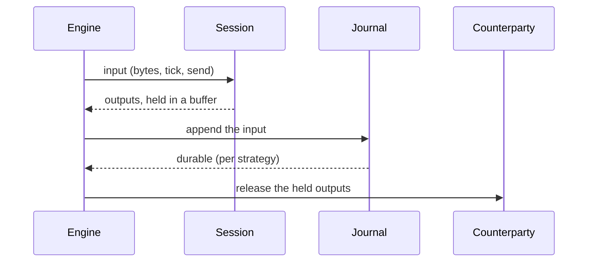

# 004 — Store and recovery

**Status:** Built (partial) · **Updated:** 2026-10-22

## Proposal

Note 001 put recovery at the centre: the costly failure in order entry is not slowness but not
knowing whether an order exists. This note makes a session survive a crash. Its journal records
everything the session was given; recovery feeds the journal back to a new session, and because
the session is deterministic (note 003, S3) it arrives at exactly the state it had, sent messages
and sequence numbers included. The journal is the source of truth (note 001: event sourcing).

The hard rule follows from the in-doubt window: **no output leaves before the input that caused
it is durable.** If a message went out and the input behind it was lost, recovery would number
the next message with a number already used, and the counterparty would see one MsgSeqNum carry
two different messages. That cannot be repaired afterwards.

It does:

- the journal: an append-only file per session, records checksummed, a torn tail detected and
  cut;
- recovery by replay, and the session store of note 003 (sent messages, for resends) rebuilt by
  it;
- the four durability strategies of note 001, each with its guarantee stated and tested, and its
  cost measured on this machine;
- crash injection: the process killed at chosen points, restarted, and checked.

It does not:

- open sockets or run the engine loop (note 005). Here a session runs in a child process,
  connected through a socketpair to a counterparty session in the parent;
- feed databases or archives (note 001: off the hot path, later, from the journal);
- compact or roll journals across days beyond a new file per sequence epoch.

## Design

**What is journaled: the session's inputs**, in the order given, each with the clock readings
it was given (both clocks of note 003's `session_time`):

| Record | Payload |
|---|---|
| connected, disconnected | none |
| bytes | the bytes the session was offered and used (not a partial message left over) |
| tick | none; only ticks that changed something are kept (D2) |
| send | MsgType and body of an application message |
| logout | the reason text |

**The order of work, per input** (D1):

The session runs first, with a sink that holds its outputs: that costs nothing, since outputs
are only bytes in a buffer, and it tells the engine whether a tick did anything (D2). Then the
input is appended, made durable as the strategy says, and only then are the outputs released.

**Record format.** `length (u32), kind (u8), mono_ns (i64), utc_ms (i64), payload, CRC32C (u32)`.
On opening, records are read until one is short or fails its CRC: that is a torn write from the
crash, its outputs were never released (by the rule above), so it is cut off. A new file starts
at each sequence reset (D4 of note 003) and records which file it follows.

**The four strategies** (note 001's table), each a policy of the journal writer:

| Strategy | Made durable | Survives | Cost on the path |
|---|---|---|---|
| A. fsync each | `write`, then `fdatasync`, before release | power loss, if the device's write cache does | one `fdatasync` per input |
| B. group commit | inputs gathered up to a bound (count or µs), one `fdatasync` for the group | power loss, as A | the wait for the group, shared |
| C. memory-mapped | stored into a mapped file; never flushed on the path | the process dying (the page cache stays) | a memory copy |
| D. replicated | sent to a standby process, which appends it to its own journal and acknowledges | the loss of this machine, if the standby is on another | a round trip |

On this machine: the journal lives on `/` (ext4 on an HPE Smart Array logical volume; `/tmp` is
memory), whose write cache the kernel sees as write-through. A probe (2,000 appends of 200 bytes,
each with `fdatasync`, normal mode): p50 130 µs, p99 261 µs, max 616 µs, too fast for the disks
alone, so the controller's cache is absorbing writes. Checked with `ssacli` (Review): the cache is
battery-backed (1.8 GB, 90% for writes), no-battery write caching is off and the drive's own
cache is off, so A and B survive power loss here. The volume is one 1 TB SAS disk in RAID 0: no
redundancy, so a disk failure loses the journal, which only D (a standby elsewhere) covers. A run
that writes faster than one disk drains would fill the cache and see `fdatasync` at disk speed;
each benchmark run records how much it wrote.

**Recovery.** Open the newest file, cut any torn tail, and replay every record into a new session
whose sink discards writes (they went out before the crash) and whose store records sent
messages as replay produces them. The session is then where it was. Messages already sent but
never acknowledged are recovered by the protocol itself: on the next logon the counterparty's
ResendRequest, or ours, covers them (note 003).

**The store** (note 003's interface) keeps sent messages in memory, appended in order, indexed by
sequence number (D3). It is rebuilt by replay on every start, so it is never a second source of
truth that could disagree with the journal.

**Crash injection.** Fail points compiled into a test build: before the append; mid-append (half
a record written, then `_exit`); after the append, before durable; after durable, before release;
mid-release (some outputs written); during a resend. The child is killed at the point, restarted
with recovery, and the test checks, against the counterparty's record of everything it received:
no MsgSeqNum ever carries two different messages; numbers continue without reuse; every message
the counterparty asks to be resent is resent or gap-filled. Power loss is not killable for real:
it is simulated by cutting the journal back to its last durable offset (as the strategy defines
durable) before the restart, which shows C failing exactly as its guarantee says.

**Measurement.** Per strategy: the time from input to release, as percentiles, per record size
and rate, open loop, with `lockfree-ipc`'s harness, in bench mode, the journal on `/`; group
commit at several bounds; replay speed (records per second) for the restart cost. D on one
machine runs over loopback and states so: it measures the protocol, not a network.

**Decisions for agreement:**

- **D1. Journal before release** (proposed) against *release, then journal*: the second is faster
  and loses the in-doubt guarantee (a reused MsgSeqNum after a crash). Proposed without a real
  alternative to measure, but stated, because it is what an engine does if this is not decided.
- **D2. Ticks journaled only when they did something** (proposed: the held outputs show it, and a
  tick that changes nothing need not be replayed) against *every tick* (simpler, and a record per
  tick at whatever rate the engine ticks).
- **D3. The store rebuilt in memory by replay** (proposed: one source of truth; the cost is
  startup time, measured) against *a persisted index of sent messages* (faster restart, a second
  file that must agree with the journal after every crash).
- **D4. Strategy D's standby.** (a) Built and measured over loopback on dev-lnx01, stated as the
  protocol's cost without a network (proposed); (b) left out until there is a second Linux
  machine.

## Spec

- S1. Journal-before-release holds: in every crash-injection test, no MsgSeqNum the counterparty
  received is ever used again for a different message.
- S2. After a restart at any fail point, the recovered session's state and sent messages equal
  those of a session that ran the same inputs without crashing (replay determinism).
- S3. A torn tail (any length of a partial record) is detected and cut; every complete record
  before it is kept.
- S4. Each strategy's guarantee is tested: A, B and D survive the process dying at any point and
  the simulated loss of everything not yet durable; C survives the process dying and is shown to
  fail the simulated power loss as stated.
- S5. Each strategy's input-to-release time published as percentiles beside the others, in bench
  mode, three runs, with group commit at three bounds; replay speed published.
- S6. Appending a record allocates nothing (compiled-code check); the only system calls on the
  path are the strategy's own (`write`, `fdatasync`, the socket for D).

## Tasks

- [x] Record format, writer, reader with torn-tail cut; S3
- [ ] Held-output sink and the engine step (input, append, durable, release); store; replay
- [ ] Strategies A, B, C; then D (standby process)
- [ ] Fail points; crash tests in a child process; simulated power loss; S1, S2, S4
- [ ] Benchmark; three bench-mode runs; S5; S6 check
- [ ] Review

## Review

| Date | Stage | Finding |
|---|---|---|
| 2026-10-22 | Draft | Written for review. Storage examined first: `/` is ext4 on one Smart Array logical volume, write cache write-through as the kernel sees it; `fdatasync` probe p50 130 µs |
| 2026-10-22 | Agreed | Approved by Shep, D1–D4 as proposed. On D2: the session has no clock of its own, so the engine calls `on_tick` often (perhaps every loop pass) to let its timers fire; almost every call finds nothing due and changes nothing. Only a tick that produced output or a disconnect is journaled, with its clock readings, so replay reproduces that message with the same MsgSeqNum and SendingTime; skipping the rest is safe because a tick that does nothing changes no state (every timer branch in the session writes or disconnects; S2 checks replay equality). Open: the Smart Array cache's protection, for A's and B's guarantee |
| 2026-10-22 | Agreed | Controller cache checked by Shep in iLO: cache module OK, logical drive OK, Smart Storage Battery OK, so the Smart Array's write cache is flash-backed and protected, which with the 130 µs `fdatasync` means writes are absorbed there. Not yet seen: whether the physical drives' own (unprotected) write caches are disabled, and whether no-battery write caching is off (needs `ssacli`). Until then A and B are stated as surviving power loss with the controller cache protected and the drive caches unverified |
| 2026-10-22 | Agreed | `ssacli` 6.45 (the package from HPE's noble pool, SHA-256 checked against its index; no repository added) on the P440ar, firmware 7.00: Cache Status OK, battery-backed cache 1.8 GB (10% read, 90% write), backup power Batteries, Battery/Capacitor Status OK, No-Battery Write Cache Disabled, Drive Write Cache Disabled (the drive, HP MM1000FBFVR SAS HDD, reports its write cache disabled). A and B therefore survive power loss on this machine. Logical drive 1: RAID 0 (Fault Tolerance 0) on that one disk; a disk failure loses the journal |
| 2026-10-22 | Built (partial) | `include/fixgw/journal.hpp`: the header (magic, epoch), the record (length, kind, both clocks, payload, CRC32C), `journal_file` (create, refusing an existing file; append after a cut), `journal_reader` (whole file read, records until the first short, oversized or CRC-failing one, `cut()` truncating to the last complete record and syncing). CRC32C by SSE4.2 on x86-64-v3, by the ARMv8 CRC instructions where the build enables them, otherwise by table (CI's arm64 build takes the table path); the hardware path equals the table at every length 0–280 and alignment 0–15, and both give the standard check value E3069283. `tests/journal_test.cpp`: every record kind read back exactly; S3 at each of the 106 lengths inside a last record with a payload; cut then append; a corrupted record and an oversized length stop the read; a wrong header refused. UBSan found `memcpy` given an empty view's null pointer (undefined even for 0 bytes) in the record encoder, and the same pattern in encoder B's `add` and `add_raw` (never hit by a test before); all three guarded. Clean under ASan and UBSan, without SSE4.2, and the aarch64 build compiles |
