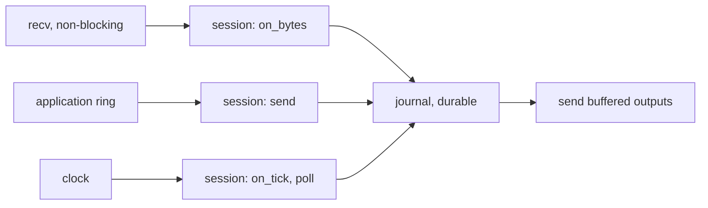

# 005 — Transport and engine loop

**Status:** Measured · **Updated:** 2026-10-23

## Proposal

Notes 002 to 004 built a session that never touches a socket, a clock or a thread: bytes and time
in, bytes and actions out, journaled before anything leaves. This note gives it the world:
TCP connections in both roles, a thread that runs it, the application's way in and out, and
the measurements of what the kernel's network path costs beneath it.

Note 001 put two arrangements of the work up to be measured against each other: one thread doing
everything in order (receive, process, journal, make durable, send), and a pipeline in the
manner of the LMAX Disruptor, where the session runs ahead while earlier inputs are being made
durable, and a separate stage sends each output once its input is durable. Both are built here,
both keep note 004's rule (no output before its input is durable), and the choice is made from
the numbers.

It does:

- non-blocking TCP: the initiator connects and reconnects with backoff; the acceptor listens,
  reads the first message of each connection (its Logon) and hands the connection to the
  session it names, or closes it;
- `TCP_NODELAY`, send buffering when the kernel's is full, and a bound past which a counterparty
  that does not read is disconnected;
- the engine loop, one pinned thread per session, waiting for input in one of the ways of D1;
- the application's interface: two `lockfree-ipc` SPSC rings per session (D5);
- duplicate identity (scenario 1S b of note 003): a Logon for a session already connected is
  refused at the acceptor, before any session sees it (D6);
- measurements: the TCP round trip on this machine per wait mode, and the order path from the
  application's ring to the counterparty and back, direct loop against pipeline.

It does not:

- run the conformance suite (note 006) or the order state machine (note 007);
- measure against QuickFIX (note 008);
- use kernel bypass: there is no such card here (note 001). The kernel path is measured and its
  floor stated.

## Design

**The network on this machine.** One interface has a link: `eno1`, Broadcom BCM5719 at 1 Gb/s
(`tg3`). Unused: a dual-port Broadcom BCM57810 at 10 Gb/s (`bnx2x`, `ens1f0`/`ens1f1`, NUMA
node 0), 10GBASE-T copper ports (RJ-45), no cable. A counterparty process on this machine reached over loopback never touches a
card: loopback measures the kernel's TCP code alone, a floor below any real network. The two
BCM57810 ports joined by a cable, one of them in its own network namespace, would put a real card
and driver on the path within one machine (D3).

**The direct loop** (one thread, pinned, no locks):

Each pass: read the socket (`recv` with `MSG_DONTWAIT`), drain the application's ring, read the
clock and tick, flush any unsent bytes. The journal's `fdatasync` (note 004's A) happens inside
the pass: while it runs (~45 µs), nothing else on this session moves.

**The pipeline** (in the manner of the LMAX Disruptor): three stages, each on its own pinned
thread, joined by single-producer rings and sequence numbers:

1. *session*: as in the direct loop, but appends each input to the journal and moves on, putting
   its held outputs on a ring tagged with the input's journal position;
2. *journal*: makes appended records durable (`fdatasync` of everything appended so far) and
   publishes the durable position;
3. *sender*: sends each output once the durable position has passed its input's.

Note 004's rule holds by construction: the sender reads nothing the journal stage has not passed.
What it buys: the session keeps processing while a `fdatasync` is in flight, and one `fdatasync`
covers every input appended meanwhile, like group commit without its wait. What it costs: two
more threads (cores, when they spin) and hand-offs between cores (each a cache-line transfer,
note 006 of `lockfree-ipc`: ~100–250 ns).

**Sending.** Outputs go to the socket at once; whatever the kernel does not take (`EAGAIN`) is
kept in a per-connection buffer, in order, and sent first next pass. Past a configured size the
counterparty is not reading: the session logs out and disconnects.

**The acceptor's first message.** A new connection is read until one whole message has arrived,
which must be a Logon. Its SenderCompID and TargetCompID name the session; no session configured
for them, or one already connected (D6), and the connection is closed without a reply (scenario
1S b and c). Otherwise the connection, and the bytes read so far, go to that session's thread.

**Decisions for agreement:**

- **D1. How the loop waits for input.** (a) *Busy-poll*: the thread never sleeps, reading the
  socket and the ring in a loop; the lowest latency, a core per session at 100%. (b) *Block in
  `epoll_wait`* with the ring's doorbell an `eventfd`; no core burned, a wake-up (microseconds,
  more from deep idle states) on every input. (c) *Spin, then block*: spin for a configured time
  after the last input, then block. Proposed: build all three, measure them, (a) the default for
  the measured order path, and state the cost in cores beside the latency.
- **D2. Kernel busy polling** (`SO_BUSY_POLL`, `SO_PREFER_BUSY_POLL`, epoll's `EPIOCSPARAMS`):
  the kernel polls the card's queue for the socket instead of waiting for its interrupt. It only
  acts where there is a card (D3); over loopback it does nothing. Proposed: measured on the card
  path if D3 is (a), with the exact options checked against kernel 7.0's own documentation when
  built (what I found so far is mailing-list proposals, not the merged text).
- **D3. The card on the path.** (a) Join the two BCM57810 ports with a Cat6a patch cable (the
  ports are 10GBASE-T copper), one port in its own network namespace, so the counterparty's
  traffic crosses a real card and driver; (b) loopback only, stated as the floor without a card.
  10GBASE-T's line coding costs about 2–2.6 µs per link, published figures say, against ~0.3 µs
  for SFP+ direct-attach: a card path here would show that cost, which a trading venue's SFP+ or
  fibre links do not have, and the figures must say so. Proposed: (a), with that stated.
- **D4. Direct loop against pipeline.** Both built and measured (note 001), the default chosen
  from the numbers. Proposed as stated; the decision is which to build first: the direct loop,
  which the tests of notes 003 and 004 already describe.
- **D5. The application's rings.** Two `lockfree-ipc` SPSC rings per session, fixed slots of
  512 bytes: into the session, an order's MsgType and body (note 003's `send`); out, each
  application message delivered (note 004's `deliver`, with its replayed flag) and session
  events. A larger message is refused at the ring. The alternative, `lockfree-ipc`'s shared-memory
  transport for an application in another process, comes with the integration repo.
- **D6. Duplicate identity at the acceptor**: a registry of connected identities (SenderCompID,
  TargetCompID); a second Logon for one already connected is closed without a reply, and the
  first connection is untouched. Proposed as stated; the alternative (log out the first, accept
  the second) is what some venues do, and it hands a session to whoever connects last.

## Spec

- S1. Over real TCP (loopback, with send and receive buffers forced small so reads and writes
  split anywhere), both roles exchange messages intact and in order, with partial writes resumed.
- S2. No output reaches the socket before its input is durable, in both the direct loop and the
  pipeline: note 004's crash tests run through real sockets against each, with the same results.
- S3. A second Logon for a connected identity is closed with nothing sent; the first session is
  unaffected (scenario 1S b).
- S4. The initiator reconnects after the connection drops, with backoff, and the session resumes
  its sequence numbers (notes 003, 004).
- S5. Published, in bench mode, three runs each: the TCP round trip of a 200-byte message per wait
  mode (D1) on loopback, and on the card if D3 is (a); the order path (the application's ring to
  the counterparty and the ExecutionReport back to the application's ring) for the direct loop and
  the pipeline, with strategy A; cores used beside each.
- S6. A pass of the loop that moves a message allocates nothing (compiled-code check); its system
  calls are only the socket's and the journal's.

## Tasks

- [x] Transport: sockets, both roles, send buffering, reconnect; S1, S4
- [x] The acceptor's first message and the identity registry; S3
- [x] The direct loop with the application's rings; the three wait modes
- [x] The pipeline (session, journal, sender); S2 for both
- [x] Benchmarks: TCP round trip, order path; three bench-mode runs; S5; S6 check
- [x] Review

## Review

| Date | Stage | Finding |
|---|---|---|
| 2026-10-23 | Draft | Written for review. Network examined first: `eno1` (BCM5719, 1 Gb/s, `tg3`) the only link; BCM57810 dual 10 Gb/s (`bnx2x`, NUMA node 0) unused, no cable, its ports 10GBASE-T copper (`ethtool`: twisted pair, 100M/1G/10G); `net.core.busy_poll` and `busy_read` 0 |
| 2026-10-23 | Agreed | Approved by Shep, D1–D6 as proposed: all three wait modes built and measured, busy-poll the default for the measured path; kernel busy polling measured on the card path, its options checked against kernel 7.0's documentation; the card path by a Cat6a cable between the two 10GBASE-T ports (one in its own namespace), with the 10GBASE-T line-coding cost stated (the cable to be confirmed with Shep before the measured runs); the direct loop first, then the pipeline; two SPSC rings of 512-byte slots per session; a second Logon for a connected identity closed silently |
| 2026-10-23 | Built (partial) | `include/fixgw/transport.hpp`: socket set-up (non-blocking, `TCP_NODELAY`, optional buffer sizes), a listener and non-blocking accept, a non-blocking connect with a check that never blocks, `tcp_connection` (reads what has arrived; writes go to the kernel at once and whatever it will not take is kept, in order, and sent first by `flush`; past a bound, default 4 MB, `write` reports the counterparty as not reading), `backoff` (at once, then 1 s doubling to 30 s, reset on logon). `tests/transport_test.cpp`: a journaled initiator and a plain acceptor over loopback TCP, buffers of 128 KB, reads of 97 bytes: 20,000 orders in a burst arrive intact and in order with up to 2 MB kept for the kernel, and 20,000 ExecutionReports the other way; the counterparty drops the connection, it is seen, the initiator reconnects, logs on with its numbers continuing and the next order arrives; connecting to nothing fails; the backoff schedule; a counterparty that never reads trips the bound. Found on the way, both in the test, not the transport: buffers of 4 KB stalled the transfer, because loopback's ~64 KB segments never fit the window and TCP fell back to its zero-window probes; and a burst of 3,000 sometimes fitted wholly in the kernel's buffers (Linux doubles what is asked), leaving nothing to keep, so the burst is now 20,000 (30 runs, none failing). A mutant letting new bytes overtake kept ones broke S1. Clean under ASan and UBSan and TSan; aarch64 compiles |
| 2026-10-23 | Built (partial) | `include/fixgw/acceptor_gate.hpp`: each accepted connection held until its first whole message (framed and decoded with note 002's code); a Logon whose SenderCompID and TargetCompID name a configured session not already connected is admitted, the connection and every byte read so far handed to that session; anything else closed with nothing sent: not a Logon, garbled, longer than the limit (default 4 KB), an unknown identity (1S c), an identity already connected (1S b, D6, the first connection untouched), silence past the limit (default 10 s) or a hang-up; the identity is free again when its session reports it disconnected. `tests/acceptor_gate_test.cpp`: each of those, over loopback, the client checking it read end-of-file with nothing before it; a Logon in two pieces waits, then is admitted with the bytes after it; after release the identity is admitted again. A mutant dropping the already-connected check broke S3. Clean under ASan and UBSan and TSan; aarch64 compiles |
| 2026-10-23 | Built (partial) | `include/fixgw/engine.hpp`: the direct loop. `app_slot` (512 bytes: kind, MsgType, up to 504 bytes, D5) and `app_ring` (`lockfree-ipc`'s SPSC ring, 1,024 slots each way); `submit_order` for the application, ringing an `eventfd` doorbell for an engine that blocks. `engine`: one session, its connection (the initiator connects with backoff, the acceptor adopts what the gate admitted with the bytes it read), and a pass that reads the socket into the session, takes the application's orders, ticks and polls the journal, and flushes kept bytes; application messages go to the outbound ring, or, if the application is behind, to an overflow kept in order, never dropped; a counterparty not reading is logged out and disconnected. Waits (D1): busy-poll; block in `epoll_wait` on the socket and the doorbell with a 1 ms limit, so ticks and B's bound still fire; spin for 50 µs after the last activity, then block. `tests/engine_test.cpp`: the engine on its own thread, the test as application and counterparty (an ExecutionReport for each order): 2,000 orders, every report reaching the application once and in order, in each wait mode, and with the connection dropped halfway (in-flight orders resent, one reconnection). A first version of the drop test never dropped (it waited for exactly 1,000 reports, and a pass can read several); fixed, 20 runs, none failing. Clean under TSan (engine and application on separate threads through the ring) and ASan and UBSan; aarch64 compiles |
| 2026-10-23 | Built (partial) | `include/fixgw/pipeline.hpp`: the pipeline (D4). `pipeline_journal`, the session stage's strategy: writes each record and publishes how far, never waits; the journal stage loops on `fdatasync` and publishes the durable position; every output the session releases is tagged with the journal position its input reached and put on a stage ring (`lockfree-ipc` SPSC, 512-byte chunks, longer outputs in several); the sender stage holds each chunk until the durable position passes its tag, then writes it to the socket or the application's ring. No change to `journaled_session`: its strategy says durable at once, and the tag carries the rule across threads. Built for one connection's lifetime: a lost connection ends the run (reconnection is the direct loop's, and worth building here only if the pipeline wins). `tests/pipeline_test.cpp` (the counterparty helpers moved to `tests/venue.hpp`): 2,000 orders and their ExecutionReports through the pipeline with a pre-filled journal and real `fdatasync`, all in order; 2,098 records made durable by 206 `fdatasync` calls, about ten inputs a call, where the direct loop makes one call per input. 20 runs, none failing; TSan (three stages and the application on four threads) five runs, no warnings; ASan and UBSan clean; aarch64 compiles |
| 2026-10-23 | Built (partial) | **S2** (`tests/engine_crash_test.cpp`): our initiator in a child process, the direct loop (strategy A) or the pipeline, the application submitting 30 orders through its ring; the parent kills it with SIGKILL at a random moment (0–25 ms in; one to three kills a run) wherever it is, and a new child recovers from the journal (starting afresh if it was killed before the journal existed) and finishes. Power loss is simulated by zeroing the journal past the last position the child reported durable; the report is made before anything waiting on it can move (the direct loop inside `make_durable`, the pipeline through a hook called after its `fdatasync` and before it publishes). Per run: no MsgSeqNum carried two different messages, every order arrived once, the sequence never went back. Result: 25 runs each, about 49 kills each, all correct, for the direct loop and the pipeline, killed and with power loss; three repeats the same. **Two real bugs found on the way.** (1) `journal_file::create` zero-filled the pre-fill before writing the header, so a kill in between left a journal without a header, which recovery refuses: the session could never start again. Now the file is built under a temporary name (header, pre-fill, synced), renamed into place and the directory synced: a crash leaves no journal or a whole one (recorded in note 004 too). (2) The pipeline's sender read its stop flag twice when the stage ring was empty; if it turned true in between, the loop fell through holding the previous chunk and sent it again: the counterparty saw MsgSeqNum 31 twice and logged out "MsgSeqNum too low". Found by tracing a failing run frame by frame; now one reading decides. `pipeline_test` had not caught it because it checked what reached the application, not what the counterparty received twice |
| 2026-10-23 | Built (partial) | CI's TSan job (run 39945015820) found a data race the local runs had not covered (TSan had not been run on `engine_crash_test`): `engine::connected()`, asked from the application's thread, read the connection's descriptor while the engine thread attached it. The connection is the engine thread's alone; `connected()` now reads an atomic flag the engine thread publishes at the end of each pass. `engine_crash_test`, `engine_test` and `pipeline_test` under TSan locally: no warnings |
| 2026-10-23 | Built (partial) | **Check run, bench mode** (scratchpad, `d3e3901`, every point complete; `bench-run` started inside the namespace keeps it, so the card path really crossed the cable). TCP round trip p50: loopback 7.5 µs busy-poll, 13.9 block, 7.5 spin-then-block; card 40.0, 44.7, 40.1. Order path p50 (two `fdatasync` calls per order: the order journaled before it is sent, its ExecutionReport before it reaches the application): loopback direct 122 µs at 1,000/s and 237 at 10,000/s (near saturation), pipeline 107 and 99; card direct 150 and 233, pipeline 140 and 149. The card adds ~32 µs to a round trip: 10GBASE-T's line coding perhaps 5 µs, the rest consistent with the card's receive interrupt coalescing (`rx-usecs` 24, paid at each end). **D7, agreed with Shep:** besides kernel busy polling (D2), measure the card with receive coalescing off (`rx-usecs` 0 on both ports, restored to 24 after), to tell the two remedies apart. Each run now records `net.core.busy_read`, `busy_poll` and the card's `rx-usecs`. D2's mechanism, checked against socket(7): `SO_BUSY_POLL` is in microseconds and raising it needs `CAP_NET_ADMIN`, which a run started by `bench-run` as the user lacks, so the system defaults (`busy_read` for receives, `busy_poll` for poll and epoll) are set by root for the run instead |
| 2026-10-23 | Built (partial) | **The card path, diagnosed** (check runs, bench mode, scratchpad, `c8350a9`; each run records `busy_read`, `busy_poll` and the card's `rx-usecs`). Card round trip, busy-poll wait, p50: default 40.0 µs; coalescing off (`rx-usecs` 0) 40.3, no effect; Energy-Efficient Ethernet off 40.1, no effect (it was on and active, but enters low-power idle only after 2.56 ms without traffic); kernel busy polling at 50 µs (D2) 31.4, so the interrupt path costs ~9 µs a round trip and busy polling removes it; loopback 7.5. The remaining ~24 µs is inside the card: 10GBASE-T's PHYs perhaps 5 µs over the two links, the rest in the card's MAC, DMA and PCIe path, not separable by software timing (the BCM57810's hardware timestamps could split it: an option, not done). The order path hardly moves with any of these (its ~100–150 µs is the two `fdatasync` calls an order pays). A first attempt at the busy-poll run did not run: it set the sysctls inside the namespace too, where they are not present, and the chain stopped; they are system-wide, set once in the main namespace. Published set (S5): loopback, card, and card with busy polling, three runs each; coalescing-off and EEE-off stay here as diagnostics. **S6** (`tests/engine_alloc_test.cpp`): every allocation by any thread but the test's own counted (the global allocator replaced), none allowed while 2,000 orders and ExecutionReports flow after warm-up: 0 for the direct loop and 0 for the pipeline's three stages. Proved by a mutant first: the counter at first never started (it waited for exactly 200 reports, and a pass can collect several, the drop test's mistake again), and a temporary-string mutant was removed by the compiler (an allocation that never escapes may be elided); with `>=` and an escaping allocation the mutant shows 267. Not exercised: the rare paths that may grow a buffer (the kernel's send buffer full, the application far behind) |
| 2026-10-23 | Built (runs) | **Nine runs published**, one bench-mode session, `4970988`, clean, every point complete: loopback `results/net-dev-lnx01-20261023T160514Z.json`, `160612Z`, `160709Z`; card `160807Z`, `160914Z`, `161022Z`; card with busy polling at 50 µs `161130Z`, `161235Z`, `161340Z`. TCP round trip p50, busy-poll wait: loopback 7.3–7.5 µs, card 39.5–40.1, card with busy polling 30.8–31.2; blocking in epoll adds ~6 µs on loopback and ~2–6 on the card, and nothing with busy polling (the kernel polls before it sleeps); spin-then-block equals busy-poll (the 50 µs spin covers a round trip). Order path p50: direct 123 µs at 1,000/s and 238–240 at 10,000/s on loopback (near saturation: two `fdatasync` calls an order, ~90 µs of each 100 µs), 151 and 234–235 on the card; pipeline 107 and 99 on loopback, 139–141 and 153–184 on the card, 135 and 148–150 with busy polling. The pipeline is the faster loop at every point, by 16 µs at 1,000/s and by more than half at 10,000/s on loopback, where the direct loop is saturating; it costs two more cores while they spin. Busy polling takes ~9 µs off a card round trip and a few µs off the order path. Open, observed and not investigated: the pipeline at 10,000/s on the card varies between runs (p50 153–184 µs, p99 steady at 191–195), like two operating points; the coalescing-off check run showed the same 183 µs level. Against the Spec: S1, S4 (transport_test), S2 (engine_crash_test), S3 (acceptor_gate_test), S5 (these runs), S6 (engine_alloc_test) |
| 2026-10-23 | Measured | Reviewed and approved by Shep against the Spec: S1–S6 met as recorded above. Open, carried forward: the pipeline's two levels at 10,000/s on the card (p50 153–184 µs); the ~24 µs inside the card (hardware timestamps would split it); reconnection in the pipeline (built only if the pipeline becomes the default) |
| 2026-10-23 | Measured (open item 1 closed) | **The pipeline's two levels at 10,000/s on the card, explained.** Every published run made one `fdatasync` per journal record (1.001–1.004 records a sync), so inputs were not grouped. Probe (scratch copies of the benchmark programs; repo unchanged; loopback, journals on ext4, off the fence): the counterparty's reply delayed by D µs, pipeline at 10,000/s. p50 rose with D to 30 µs (124 → 155), jumped between 30 and 40 (to 186), and stayed flat to 80 (186–188), then queued at 90–100; at a fixed D it was bistable (36 µs: 185 in three runs; 44 µs: 147 in one, 186 earlier); records per sync stayed ~1.00 either side, so the reply was not being grouped with the next order (my first explanation, wrong). p50 per 1,000-order window: each level holds for thousands of orders, with occasional switches (186 ×8 then 152 152; 184 165 185 156 …); at 5,000/s there is no second level (136–146, steady, four runs). Cause: at 10,000/s the single journal stream is ~90% busy, two `fdatasync` calls an order (the order's record and its ExecutionReport's) of ~45 µs each in a 100 µs interval, and at that load it has two stable cycles: in one each order's record finds the journal idle; in the other it arrives during the previous report's sync and waits ~35 µs, and the wait sustains itself (the late order makes its report late, whose sync delays the next order). The card's round trip, ~33 µs longer than loopback's, sits where both are stable; loopback and the card with busy polling (9 µs less) sit clear of it. What it implies: at 10,000/s the pipeline is near its journal's capacity; the figure that sets it is two syncs an order. A possible remedy, for note 007 to decide since it touches note 004's D1: deliver an inbound message to the application before its record is durable (after a crash the counterparty resends it with PossDup, and the application must discard the duplicate by ExecID, as its order state machine must anyway), halving the syncs an order pays |
| 2026-10-23 | Measured (open item 2, in progress) | **The ~24 µs inside the card, first split.** The BCM57810 offers hardware timestamps (`ethtool -T`: transmit on/off; receive only for PTP event packets; stamped at the MAC; one clock per port). A probe of my own (PTP-shaped UDP to port 319, unicast, scratchpad) got software stamps at both ends and no hardware stamp at all, though the driver accepted the configuration (transmit on, filter `PTP_V2_L4_EVENT`). `linuxptp` 4.4 (`ptp4l`, installed with Shep's agreement, `--no-upgrade`), master on ens1f0 and slave on ens1f1 in the namespace, UDPv4, hardware timestamping, 40 s: the clocks converged to ±11 ns and the **one-way path delay between the two MACs was 2,615–2,618 ns**, steady: the PHYs and the cable, matching 10GBASE-T's published ~2.6 µs a link. Of the card round trip's ~24 µs left after busy polling (31.4 µs against loopback's 7.5), 5.2 µs is therefore PHYs and cable (both ways), and ~18–19 µs is the four passes between MAC and host (our transmit, the far end's receive and transmit, our receive): the card's DMA, PCIe, and the driver. `ptp4l` sends to the PTP multicast address 224.0.1.129; the probe's unicast is the likely reason it got no stamps |
