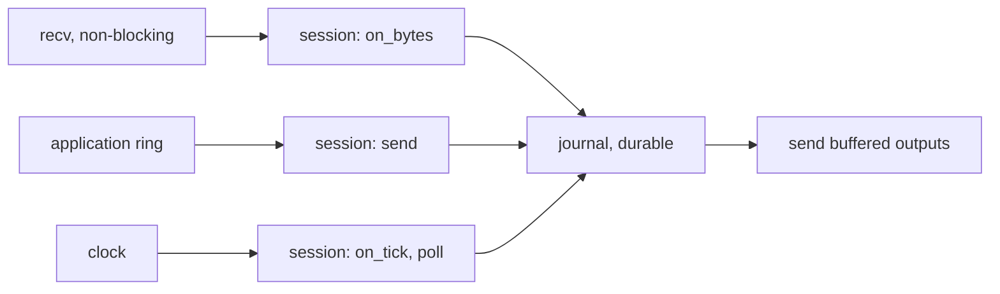

# 005 — Transport and engine loop

**Status:** Draft · **Updated:** 2026-10-23

## Proposal

Notes 002 to 004 built a session that never touches a socket, a clock or a thread: bytes and time
in, bytes and actions out, journaled before anything leaves. This note gives it the world:
TCP connections in both roles, a thread that runs it, the application's way in and out, and
the measurements of what the kernel's network path costs beneath it.

Note 001 put two arrangements of the work up to be measured against each other: one thread doing
everything in order (receive, process, journal, make durable, send), and a pipeline in the
manner of the LMAX Disruptor, where the session runs ahead while earlier inputs are being made
durable, and a separate stage sends each output once its input is durable. Both are built here,
both keep note 004's rule (no output before its input is durable), and the choice is made from
the numbers.

It does:

- non-blocking TCP: the initiator connects and reconnects with backoff; the acceptor listens,
  reads the first message of each connection (its Logon) and hands the connection to the
  session it names, or closes it;
- `TCP_NODELAY`, send buffering when the kernel's is full, and a bound past which a counterparty
  that does not read is disconnected;
- the engine loop, one pinned thread per session, waiting for input in one of the ways of D1;
- the application's interface: two `lockfree-ipc` SPSC rings per session (D5);
- duplicate identity (scenario 1S b of note 003): a Logon for a session already connected is
  refused at the acceptor, before any session sees it (D6);
- measurements: the TCP round trip on this machine per wait mode, and the order path from the
  application's ring to the counterparty and back, direct loop against pipeline.

It does not:

- run the conformance suite (note 006) or the order state machine (note 007);
- measure against QuickFIX (note 008);
- use kernel bypass: there is no such card here (note 001). The kernel path is measured and its
  floor stated.

## Design

**The network on this machine.** One interface has a link: `eno1`, Broadcom BCM5719 at 1 Gb/s
(`tg3`). Unused: a dual-port Broadcom BCM57810 at 10 Gb/s (`bnx2x`, `ens1f0`/`ens1f1`, NUMA
node 0), 10GBASE-T copper ports (RJ-45), no cable. A counterparty process on this machine reached over loopback never touches a
card: loopback measures the kernel's TCP code alone, a floor below any real network. The two
BCM57810 ports joined by a cable, one of them in its own network namespace, would put a real card
and driver on the path within one machine (D3).

**The direct loop** (one thread, pinned, no locks):

Each pass: read the socket (`recv` with `MSG_DONTWAIT`), drain the application's ring, read the
clock and tick, flush any unsent bytes. The journal's `fdatasync` (note 004's A) happens inside
the pass: while it runs (~45 µs), nothing else on this session moves.

**The pipeline** (in the manner of the LMAX Disruptor): three stages, each on its own pinned
thread, joined by single-producer rings and sequence numbers:

1. *session*: as in the direct loop, but appends each input to the journal and moves on, putting
   its held outputs on a ring tagged with the input's journal position;
2. *journal*: makes appended records durable (`fdatasync` of everything appended so far) and
   publishes the durable position;
3. *sender*: sends each output once the durable position has passed its input's.

Note 004's rule holds by construction: the sender reads nothing the journal stage has not passed.
What it buys: the session keeps processing while a `fdatasync` is in flight, and one `fdatasync`
covers every input appended meanwhile, like group commit without its wait. What it costs: two
more threads (cores, when they spin) and hand-offs between cores (each a cache-line transfer,
note 006 of `lockfree-ipc`: ~100–250 ns).

**Sending.** Outputs go to the socket at once; whatever the kernel does not take (`EAGAIN`) is
kept in a per-connection buffer, in order, and sent first next pass. Past a configured size the
counterparty is not reading: the session logs out and disconnects.

**The acceptor's first message.** A new connection is read until one whole message has arrived,
which must be a Logon. Its SenderCompID and TargetCompID name the session; no session configured
for them, or one already connected (D6), and the connection is closed without a reply (scenario
1S b and c). Otherwise the connection, and the bytes read so far, go to that session's thread.

**Decisions for agreement:**

- **D1. How the loop waits for input.** (a) *Busy-poll*: the thread never sleeps, reading the
  socket and the ring in a loop; the lowest latency, a core per session at 100%. (b) *Block in
  `epoll_wait`* with the ring's doorbell an `eventfd`; no core burned, a wake-up (microseconds,
  more from deep idle states) on every input. (c) *Spin, then block*: spin for a configured time
  after the last input, then block. Proposed: build all three, measure them, (a) the default for
  the measured order path, and state the cost in cores beside the latency.
- **D2. Kernel busy polling** (`SO_BUSY_POLL`, `SO_PREFER_BUSY_POLL`, epoll's `EPIOCSPARAMS`):
  the kernel polls the card's queue for the socket instead of waiting for its interrupt. It only
  acts where there is a card (D3); over loopback it does nothing. Proposed: measured on the card
  path if D3 is (a), with the exact options checked against kernel 7.0's own documentation when
  built (what I found so far is mailing-list proposals, not the merged text).
- **D3. The card on the path.** (a) Join the two BCM57810 ports with a Cat6a patch cable (the
  ports are 10GBASE-T copper), one port in its own network namespace, so the counterparty's
  traffic crosses a real card and driver; (b) loopback only, stated as the floor without a card.
  10GBASE-T's line coding costs about 2–2.6 µs per link, published figures say, against ~0.3 µs
  for SFP+ direct-attach: a card path here would show that cost, which a trading venue's SFP+ or
  fibre links do not have, and the figures must say so. Proposed: (a), with that stated.
- **D4. Direct loop against pipeline.** Both built and measured (note 001), the default chosen
  from the numbers. Proposed as stated; the decision is which to build first: the direct loop,
  which the tests of notes 003 and 004 already describe.
- **D5. The application's rings.** Two `lockfree-ipc` SPSC rings per session, fixed slots of
  512 bytes: into the session, an order's MsgType and body (note 003's `send`); out, each
  application message delivered (note 004's `deliver`, with its replayed flag) and session
  events. A larger message is refused at the ring. The alternative, `lockfree-ipc`'s shared-memory
  transport for an application in another process, comes with the integration repo.
- **D6. Duplicate identity at the acceptor**: a registry of connected identities (SenderCompID,
  TargetCompID); a second Logon for one already connected is closed without a reply, and the
  first connection is untouched. Proposed as stated; the alternative (log out the first, accept
  the second) is what some venues do, and it hands a session to whoever connects last.

## Spec

- S1. Over real TCP (loopback, with send and receive buffers forced small so reads and writes
  split anywhere), both roles exchange messages intact and in order, with partial writes resumed.
- S2. No output reaches the socket before its input is durable, in both the direct loop and the
  pipeline: note 004's crash tests run through real sockets against each, with the same results.
- S3. A second Logon for a connected identity is closed with nothing sent; the first session is
  unaffected (scenario 1S b).
- S4. The initiator reconnects after the connection drops, with backoff, and the session resumes
  its sequence numbers (notes 003, 004).
- S5. Published, in bench mode, three runs each: the TCP round trip of a 200-byte message per wait
  mode (D1) on loopback, and on the card if D3 is (a); the order path (the application's ring to
  the counterparty and the ExecutionReport back to the application's ring) for the direct loop and
  the pipeline, with strategy A; cores used beside each.
- S6. A pass of the loop that moves a message allocates nothing (compiled-code check); its system
  calls are only the socket's and the journal's.

## Tasks

- [ ] Transport: sockets, both roles, send buffering, reconnect; S1, S4
- [ ] The acceptor's first message and the identity registry; S3
- [ ] The direct loop with the application's rings; the three wait modes
- [ ] The pipeline (session, journal, sender); S2 for both
- [ ] Benchmarks: TCP round trip, order path; three bench-mode runs; S5; S6 check
- [ ] Review

## Review

| Date | Stage | Finding |
|---|---|---|
| 2026-10-23 | Draft | Written for review. Network examined first: `eno1` (BCM5719, 1 Gb/s, `tg3`) the only link; BCM57810 dual 10 Gb/s (`bnx2x`, NUMA node 0) unused, no cable, its ports 10GBASE-T copper (`ethtool`: twisted pair, 100M/1G/10G); `net.core.busy_poll` and `busy_read` 0 |
