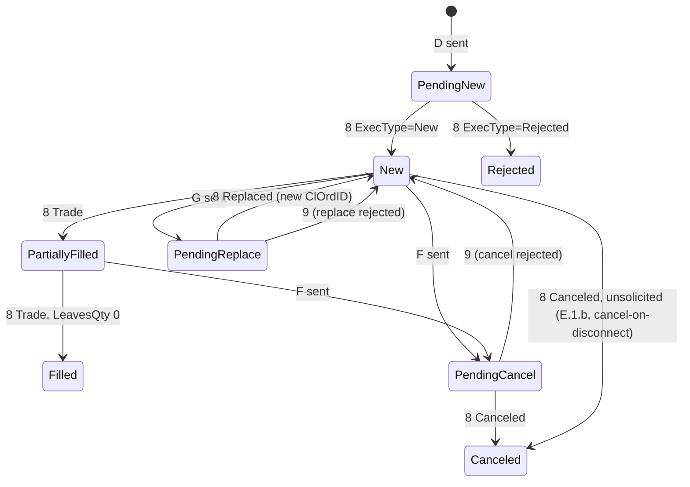

# 007 — Order entry

**Status:** Measured · **Updated:** 2026-10-24

## Proposal

Notes 002 to 006 made the message stream reliable: framed, checked, numbered, journaled before
anything leaves, recovered by replay, conformant case by case. This note puts orders on it: the
five order-entry messages, the order state machine that turns ExecutionReports into each order's
state, the outbound throttle, a venue simulator to trade against, and the cases note 001 put at the
centre of the design, where it is not known whether an order exists (note 001, S7).

Sources: FIX 4.4 with Errata 20030618, Volume 4 (*Orders and Executions*, read for this note:
ExecutionReport usage, OrdStatus precedence, the *Order State Change Matrices* A to L); Volume 2
for resend; the FIX 4.4 orchestration already fetched by note 006 (`OrchestraFIX44.xml`, which
the FIX Trading Community corrected in EP311, August 2026; our pinned commit carries it: confirmed when built,
Review). Carried here from earlier notes: 14m and 19a of the *Session Layer Test Cases*
(note 006), the stale-order hook (note 003), write-ahead in both directions (note 005: an inbound
message is durable before the application sees it), and a logout for the application (note 006:
the engines have none).

It does:

- NewOrderSingle (D), OrderCancelRequest (F), OrderCancelReplaceRequest (G) out; ExecutionReport
  (8), OrderCancelReject (9) in; BusinessMessageReject (j) both ways;
- their bodies checked against the FIX 4.4 dictionary, as note 006 checks session messages, with
  the conditional rules Volume 4 states in prose (14m: BusinessMessageReject, reason 5);
- the order state machine, one per ClOrdID chain, on the session's thread (D1), its state
  rebuilt by journal replay like the session's;
- duplicate ExecutionReports discarded by ExecID (19a);
- an outbound throttle (D4) and the stale-order policy for resends and for orders queued while
  disconnected (D5);
- the in-doubt cases as tests that inject the failure (D6, note 001 S7);
- a venue simulator: the acceptor engine with a price-time book per symbol, enough to fill,
  part-fill, rest, cancel and replace, and cancel-on-disconnect (D7);
- the *Order State Change Matrices* in scope (D2), each a scripted test, listed in
  `CONFORMANCE.md` beside the session cases, generated the same way;
- a logout and a stop for the application, through the ring, in both engines.

It does not:

- send or take OrderStatusRequest (H), mass cancel, lists, quotes or allocations: not among note
  001's five messages; the in-doubt cases are resolved without status requests (D6);
- pre-trade risk (the integration repo's, between strategy and gateway);
- measure anything: order-to-ExecutionReport latency is note 008's.

## Design

**Where orders live.** The application submits D, F and G through the ring as today; the session
thread passes each through the order state machine before the session sends it, and each inbound
8 or 9 through it before it reaches the application. The application receives the message and
the order's state after it (OrdStatus as the gateway understands it, CumQty, LeavesQty, AvgPx),
so it does not have to rebuild the chain itself. Everything the machine decides follows from
journaled inputs, so replay rebuilds it exactly, as it rebuilds the session (note 004).

(A simplification: a fill may arrive in any pending state, with the original order's
parameters, as Volume 4 requires; OrdStatus then follows its precedence table.)

**Decisions for agreement:**

- **D1. Who keeps order state.** (a) *Proposed:* the gateway, on the session thread, as above: one
  copy, rebuilt by replay, checked against every ExecutionReport (OrderQty = CumQty + LeavesQty
  while active, CumQty never falling except by a trade bust, ExecID unique), and requests for
  unknown or finished orders refused before they leave. (b) The application keeps it and the
  gateway passes messages through: less here, but every application rebuilds the same chain,
  and replay would not cover it.

- **D2. Which matrices.** (a) *Proposed:* A (vanilla), B (cancel, all six), C (replace quantity
  changes), D (replace sequencing and chaining), E.1.b (unsolicited cancel: what cancel-on-disconnect
  produces), F (duplicate ClOrdID, PossResend), I (IOC and FOK), J (trade cancel and correct: a
  bust lowers CumQty, which the state machine must accept). Out, with the reason in the table:
  E.1.a, c–e (telephoned orders, unsolicited replaces), G (needs OrderStatusRequest), H (GT orders
  over days, corporate actions), K (trading halts), L (stopped orders, CashOrderQty). (b) A–D
  only: fewer tests, but busts and IOC/FOK left unhandled.

- **D3. Duplicate ExecutionReports (19a).** An ExecutionReport whose ExecID was seen is discarded
  (logged, not delivered). (a) *Proposed:* a fixed-capacity hash set of ExecIDs for the session's
  life (configured, default 1 million, no allocation after start; full is an error logged and
  the session refuses new orders until the next reset, never a silent miss). (b) ExecIDs kept per
  order until it is finished: smaller, but a late resend for a finished order would not be
  recognised.

- **D4. Throttle.** At most N application messages per rolling window T (venue rules of
  engagement set both; a ring of the last N send times, no allocation). What happens to one over
  the limit: (a) *Proposed:* refused back to the application at once, with the time it may retry;
  an order delayed in a queue is a stale order in the making, and the application should decide.
  (b) Queued in order and sent when the window allows: simpler for the application, but latency
  becomes unbounded under load. Cancels: (i) *proposed:* counted like everything else (venues
  count them) but never refused while an order of theirs is live: they may exceed N by the number
  of live orders, because a refused cancel is a risk the throttle must not create; (ii) counted
  and refused like the rest.

- **D5. Stale orders on resend.** When the venue asks for a range we sent (its ResendRequest), a
  message in it never reached the venue. (a) *Proposed:* a NewOrderSingle or replace older than a
  configured age (default 2 s) is gap-filled, not resent, and the application is told it was never
  sent (the order becomes Rejected locally, with the reason); a cancel is always resent, unless
  its order is already finished. Gap-filling is safe exactly because the venue asked: it did not
  get the message, so the order cannot exist there. The same rule applies to orders queued while
  disconnected (note 003, D2). (b) Resend everything (FIX's default): a minutes-old order may
  trade at a price no one wants. (c) Never resend orders: simple, but loses orders that were
  only a moment late.

- **D6. The in-doubt cases (S7)**, each a test that injects the failure, then checks order and
  session state after recovery:
  1. *crash before recording:* the order is not in the journal, so it was never sent (note 004's
     D1); after restart the application is told every order the journal knows, and an order it
     submitted that is missing was not sent;
  2. *crash after sending, before the ExecutionReport:* the order is journaled and sent; after
     restart, logon and sequence recovery bring the report (resent by the venue), or the venue's
     ResendRequest shows it never arrived (then D5);
  3. *connection lost before the report:* as 2 without the crash; with cancel-on-disconnect, the
     venue's unsolicited cancels arrive after logon and are applied (E.1.b);
  4. *stale resend:* D5, both outcomes.
  No OrderStatusRequest is needed: the session's sequence recovery is complete for what the
  venue sent, and D5 is complete for what we sent.

- **D7. The venue simulator.** (a) *Proposed:* the acceptor engine with a price-time book per
  symbol (limit and market orders, IOC and FOK, part fills, cancel, replace keeping priority only
  for a quantity decrease), liquidity from resting orders other sessions placed or the test
  seeded, cancel-on-disconnect configurable per session; plus scripted responses where a matrix
  needs an order of events a book will not produce (B.1.e, the acknowledgement and the cancel
  crossing). (b) Fill everything at once, as QuickFIX's executor does: not enough for B to D.

- **D8. The application messages' dictionary.** Note 006's generator extended to components and
  nested groups. (a) *Proposed:* the five messages as FIX 4.4 defines them (any valid field in
  its place accepted), plus Volume 4's conditional rules written by hand for the fields the
  state machine uses (Price when OrdType is limit, StopPx for stops, OrigClOrdID on F and G and on
  the reports answering them, and the rest as listed in the tests): failure is
  BusinessMessageReject 5 (14m). (b) A profile: only the fields this gateway uses, others
  rejected (as venues' rules of engagement do): stricter, but a venue adding a field would break
  us.

**The application's controls.** Two new ring entries: *logout* (the engine calls the session's
logout and stops reconnecting) and *stop after logout*. Both engines. The interop test of note
006 then runs through the engine as well.

## Spec

- S1. Each matrix in scope (D2) is a scripted test against the state machine and the venue
  simulator, listed in `CONFORMANCE.md` with its result; each out of scope says why.
- S2. 14m and 19a pass and move to *pass* in `CONFORMANCE.md`.
- S3. Each in-doubt case of D6 is a test that injects the failure (SIGKILL at the point, or the
  connection dropped) and checks every order's state and the session's numbers after recovery;
  no order is lost, duplicated, or sent stale.
- S4. The order state machine and the throttle make no allocation or system call in steady
  state (the hot-path check and the allocation test extended).
- S5. Replay: the state of every order after replaying a journal equals the state before the
  crash (a property test over random scripts).
- S6. Fuzzing: the session fuzzer extended with application messages; stated executions, no
  breach of the state machine's invariants (D1), no sanitizer report.
- S7. Interoperability (note 006, S6) repeated through the engine, with cancels and replaces,
  against QuickFIX's `executor` (fills only) and its `ordermatch` example (a book).

## Tasks

- [x] Shep: agree D1–D8
- [x] Dictionary for the five messages and their conditional rules (D8, S2)
- [x] Order state machine and ExecID set (D1, D3)
- [x] Throttle and stale-order policy (D4, D5)
- [x] Application controls: logout, stop (both engines)
- [x] Venue simulator (D7)
- [x] Matrices as tests, in `CONFORMANCE.md` (D2, S1)
- [x] In-doubt tests (D6, S3); replay property test (S5)
- [x] Hot path, allocation, fuzzing (S4, S6); interop through the engine (S7)

## Review

| Date | Stage | Finding |
|---|---|---|
| 2026-10-23 | Draft | Written for review. Sources: FIX 4.4 with Errata 20030618 (the specification package from fixtrading.org, read: Volume 4's ExecutionReport usage, OrdStatus precedence and the Order State Change Matrices' list, A.1.a to L.1.b); `OrchestraFIX44.xml` at the pinned commit (the five messages: NewOrderSingle 78 members, OrderCancelRequest 23, OrderCancelReplaceRequest 77, ExecutionReport 140, OrderCancelReject 23; the orchestration has no machine-readable conditional rules, hence D8's hand-written ones); EP311 (FIX 4.4 Errors and Omissions, August 2026) noted: it corrects the orchestration, and our pinned commit is from the day it was published |
| 2026-10-23 | Agreed | Approved by Shep, every decision as proposed (option A each): D1 order state kept by the gateway on the session thread; D2 matrices A, B, C, D, E.1.b, F, I, J; D3 a fixed-capacity ExecID set for the session's life; D4 over the limit refused back to the application, cancels counted but never refused while their order is live; D5 orders and replaces older than the configured age gap-filled and reported as not sent, cancels always resent; D6 the four in-doubt tests; D7 a price-time book per symbol with scripted responses where needed; D8 the five messages as FIX 4.4 defines them plus Volume 4's conditional rules by hand |
| 2026-10-23 | Built | **Dictionary (D8, S2):** note 006's generator rewritten for every message the gateway handles (the seven session messages and D, F, G, 8, 9, j), each flattened (components inlined, header and trailer included) into one sorted table of its tags with their place (top level or a repeating group, nested up to three deep): 1,449 entries; no tag appears twice in a message, checked by the generator. The validator walks a message's fields against it with a stack of open groups; it serves decoded messages and, since fuzzing found the need (below), the application's bodies before they leave. Volume 4's conditional rules written by hand (Price for limit types, StopPx for stops, an expiry for GTD, one of the OrderQtyData quantities; OrigClOrdID on PendingCancel and Replaced, ExecRefID on busts and corrections, ExecRestatementReason on Restated, LastQty and LastPx on fills); failure: BusinessMessageReject 5. Not required on Canceled: an unsolicited cancel (E.1.b) has no OrigClOrdID. 14m passes. EP311 confirmed in the pinned commit (OrdStatus 5 present; fields marked `updatedEP="311"`), and its union datatypes honoured: SecurityIDSource (22) admits 100 and up, TargetStrategy (847) 1000 and up, PartySubIDType (803) 4000 and up, a user-defined value our checks would otherwise have rejected (14e case added). The tests' hand-built orders and reports, minimal before, now valid FIX 4.4 (`test::order_fields`, `test::report_fields`). **Order book (D1, D3, D4, D5):** `include/fixgw/orders.hpp`, inside `journaled_session`, so replay rebuilds it: check before the session sends and record after it takes the message (a refused send is not journaled); every 8 and 9 through it, its state delivered behind the message (`order_event`); D5 in the resend and release hooks. Fixed-capacity open-addressing tables over an ID arena, from `calloc`, so unused capacity costs no memory (the defaults, 65,536 orders and 1,000,000 ExecIDs, ~100 MB of address space, paid as used: `crash_test` went from 133 s to 65 s). Quantities in fixed point (1e-8). Both engines: order events, refusals (with the reason and, throttled, when to retry) and the application's logout through the ring; `finished()` published as an atomic. The logout, as the in-doubt test drove it to: once logged on and in step, reconnecting first if it must, and in step means FIX's own check (scenario 16b): a TestRequest, the Logout when its Heartbeat comes back (`session::logout_when_synced`, journaled, so replay does the same); asked again whenever a gap closes, because a TestRequest above a gap is gap-filled, not resent; a Logout unanswered when the connection goes is sent again after reconnecting. **Simulator (D7):** `include/fixgw/venue_sim.hpp`. **Matrices (D2, S1):** `tests/matrices_test.cpp`, every matrix in scope scripted (the venue's rows as given, crossings included) and, where a book produces it, simulated; listed in `CONFORMANCE.md` beside the session cases: 47 matrices, 31 pass, 16 out of scope with the reason. **S3:** `tests/indoubt_test.cpp`: 48 runs of 30 orders (12 each: pipeline killed, direct loop killed, connection dropped with cancel-on-disconnect, reconnection held past the stale limit), in one run 47 SIGKILLs and 36 drops in all (the drops vary with timing); every order's state equal to the venue's at our Logout, none twice, none stale, 232 orders reported not sent and unknown to the venue. **S4:** the book's check, record, inbound and stale rule on the hot-path check (in a subject file of their own: in the codec's file they changed its inlining), no allocation or system call; the allocation test passes with the book on the path. **S5:** `tests/replay_test.cpp`: 200 random scripts of 300 steps, every order's state equal after recovery (final states 385 New, 118 PartiallyFilled, 5,959 Filled, 14,600 Canceled). **S6:** `fuzz/fuzz_orders.cpp`, 68,724 executions in 600 s (1,522 coverage edges) and, after the logout changes, 32,291 more in 300 s, no breach, corpus committed (674 inputs); `fuzz_session` after them 209,768 executions in 300 s, clean. **Found on the way, each fixed and tested:** (1) a replace may raise a filled order's quantity (C.1.c, J.1.a): the book refused it, and C.1.c was first transcribed wrongly as a rejection; (2) an OrderCancelReject for an order the venue does not know (CxlRejReason 1) carries OrdStatus Rejected for the request: the book took it for the order's (found by the replay test's state counts); (3) an order body missing required fields left the gateway and the venue's session rejected it, leaving it PendingNew for good: the application's bodies are now checked as the venue checks them and refused before leaving (found by the fuzzer; an addition to D8, which covered inbound messages only); (4) the engines' `finished()` read the engine thread's state unsynchronised (TSan); (5) the pipeline copied an empty chunk with `memcpy` from a null pointer (UBSan); (6) a vector's growth path in the ID arena called `operator delete` (the hot-path check); (7) the application's logout under dropped connections (the in-doubt test under TSan's timing, three steps): asked while disconnected, it stopped the engine with the last reports undelivered; written into a connection already dying, it was counted done; sent as soon as logged on, it overtook a resent order the venue had not processed: hence the synced logout above; (8) the session's and the order book's growth changed the codec's inlining in the hot-path subject file: the codec, the session and the book now have a subject file each. The reconnection tests now set a long stale limit: with 2 s, a reconnect slowed by the backoff made in-flight orders stale, D5 gap-filled them, and the tests counted them missing. **Observation, for Shep:** after a lost connection the backoff waits 1 s before the first reconnect (note 005's "at once" applies to the first connection only), so orders in flight at a drop are about 1 s old when the venue asks for them; at the default stale limit of 2 s they are resent. **S7 not met as agreed:** neither QuickFIX example takes cancels or replaces at FIX 4.4 (run as black boxes: `executor` fills limit orders and answers market orders with Reject 5 on OrdType, cancels and replaces with BusinessMessageReject 3; `ordermatch` answers every order-entry message at 4.4 with BusinessMessageReject 3). Built: through the engine (pipeline, journaled) against `executor`, 500 limit orders all Filled in our book, logged out through the ring, no complaint in QuickFIX's log. Cancels and replaces against QuickFIX: Shep to decide. TSan, ASan and UBSan clean; aarch64 compiles |
| 2026-10-24 | Built (Shep's decisions) | Reviewed by Shep. **S7, option A:** `interop/qf_acceptor.cpp`, an acceptor written to QuickFIX's documented API (FIX 4.4 values written as the specification gives them, so nothing depends on QuickFIX's names), answering NewOrderSingle (New; every fifth then filled at once), OrderCancelRequest and OrderCancelReplaceRequest (canceled or replaced if live; otherwise OrderCancelReject, too late or unknown), behind QuickFIX's session layer and FIX 4.4 dictionary. `interop_test` part 4, through the engine (pipeline, journaled): 300 orders; on each New, every second replaced to 200 and every third canceled (after its replace, if both); every one ends as the rules say (filled, canceled, replaced, or new), 31 OrderCancelRejects (replaces of orders filled meanwhile), none inconsistent, logged out through the ring, no complaint in QuickFIX's log; six runs alike; in CTest with the interop label (CI x64). **The three additions** (outbound body checks, EP311's union datatypes, the synced logout): agreed by Shep. **Reconnect delay:** Shep: shorter than 1 s, as long as venues' throttling allows: `engine_config::reconnect_first_ns`, 100 ms by default, then doubling to 30 s and reset on logon (about eight attempts in an outage's first 25 s; a venue limiting logons more tightly is given a longer one); note 005 amended. Measuring it found a defect: the direct loop's `lost()` ran twice when the peer closed (a write failing with EPIPE, taken for "not reading", then the end-of-file read), doubling the delay to 200 ms and journaling a second disconnect; now once per connection, and `engine_test` requires the reconnection within 250 ms (100 ms in six runs) |
| 2026-10-24 | Measured | Reviewed and approved by Shep against the Spec: S1 to S6 met as recorded above; S7 met by option A, built after his review on the approach he chose (previous entry). Carried to note 008: order-to-ExecutionReport latency with the order book, the dictionary checks and the throttle on the path |
